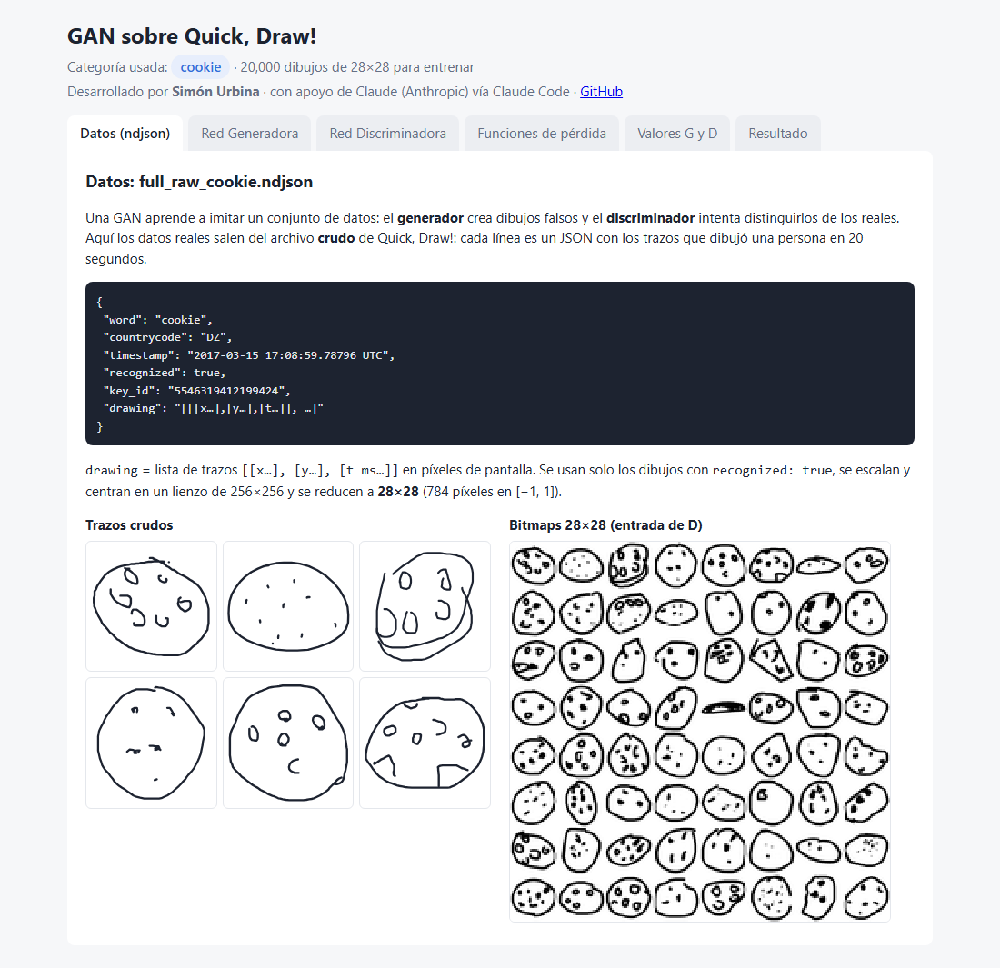
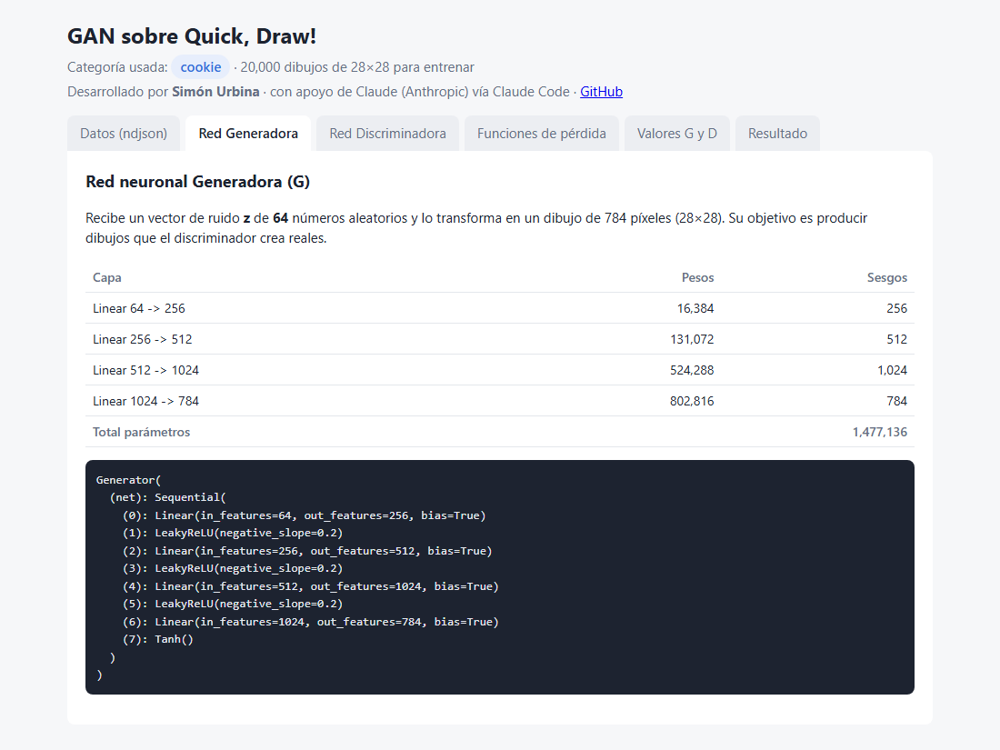
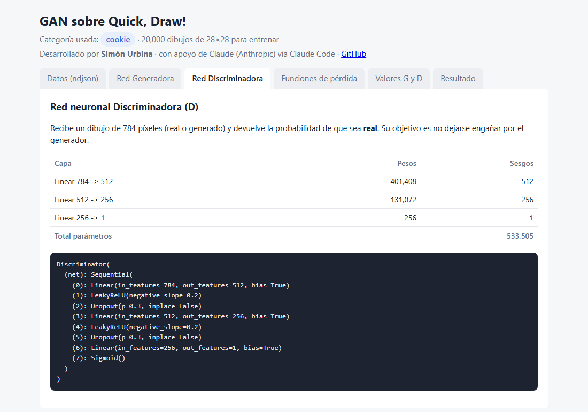
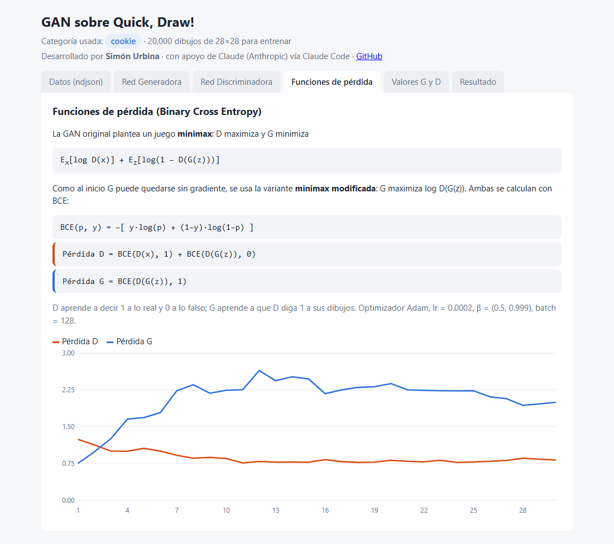
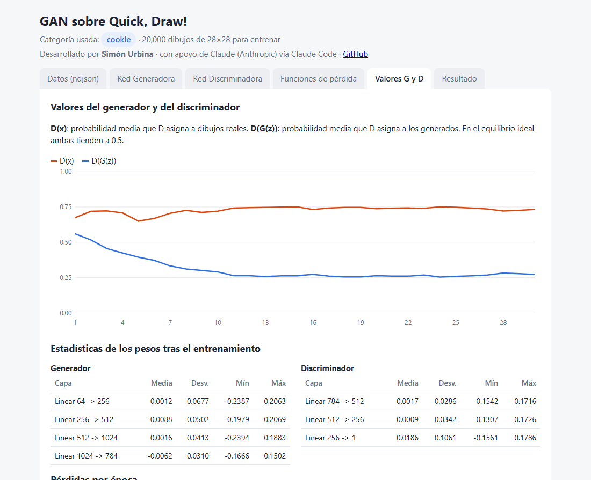
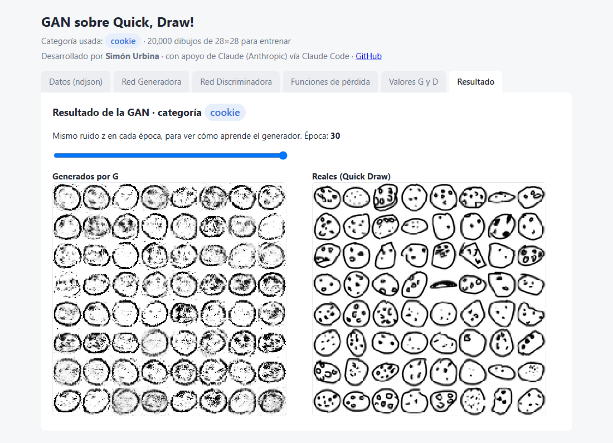

# GAN sobre Quick, Draw! — categoría `cookie`

Proyecto académico (IA Generativa, 2026-2) desarrollado con *vibe coding*: una **Red Generativa Adversarial (GAN)** que aprende a dibujar galletas a partir de los trazos crudos del dataset [Quick, Draw!](https://quickdraw.withgoogle.com/data) (`full_raw_cookie.ndjson`), más un frontend sencillo que explica sus parámetros, funciones de pérdida y resultados.

**Desarrollador:** Simón Urbina ([@Simon-Urbina](https://github.com/Simon-Urbina)) · desarrollado con el apoyo de **Claude** (Anthropic), mediante Claude Code.

**Categoría usada: `cookie` (galleta)** — 20 000 dibujos reconocidos, convertidos a 28×28 píxeles.

## ¿Qué es una GAN?

Según el [curso de GANs de Google](https://developers.google.com/machine-learning/gan?hl=es-419), una GAN es un **modelo generativo**: aprende la distribución de un conjunto de datos para crear ejemplos nuevos parecidos. Tiene dos partes que compiten:

- **Generador (G):** aprende a producir datos verosímiles a partir de ruido aleatorio `z`. Sus ejemplos falsos son los "negativos" del discriminador.
- **Discriminador (D):** es un clasificador que aprende a distinguir los datos reales de los generados, y penaliza al generador cuando produce resultados poco creíbles.

El entrenamiento alterna: D se entrena un paso (con G fijo) y luego G se entrena un paso (con D fijo), usando la salida de D como señal de error. Si G mejora lo suficiente, D llega a acertar solo el 50 % de las veces: ya no distingue lo real de lo falso.

```
 ruido z ──► [ Generador ] ──► dibujo falso ──┐
                                              ├──► [ Discriminador ] ──► ¿real? (0..1)
 full_raw_cookie.ndjson ──► dibujo real ──────┘
```

[GAN Lab](https://poloclub.github.io/ganlab/) muestra este mismo proceso de forma interactiva con datos 2D: cómo el generador va transformando el ruido para acercarse a la distribución real, mientras las fronteras del discriminador se mueven. Este proyecto hace lo mismo con dibujos de 784 dimensiones (28×28) y muestra las métricas equivalentes: pérdidas, D(x) y D(G(z)).

## Los datos: `full_raw_cookie.ndjson`

Quick, Draw! reúne más de 50 millones de dibujos de 345 categorías, hechos por jugadores en menos de 20 segundos. El formato **raw** guarda una línea JSON por dibujo:

```json
{ "word": "cookie", "countrycode": "DZ", "timestamp": "2017-03-15 17:08:59.78796 UTC",
  "recognized": true, "key_id": "5546319412199424",
  "drawing": [ [[x0, x1, ...], [y0, y1, ...], [t0, t1, ...]], ... ] }
```

Cada trazo trae sus coordenadas `x`, `y` en píxeles de pantalla y el tiempo `t` en ms. Como no vienen normalizadas, `gan.py` hace este preprocesado:

1. Se queda con los dibujos `recognized: true`.
2. Escala y centra cada dibujo en un lienzo de 256×256 conservando su proporción, y dibuja los trazos.
3. Lo reduce a **28×28** y pasa los píxeles a [−1, 1] (el mismo rango que la salida Tanh del generador).



## Estructura

| Archivo | Contenido |
|---|---|
| `gan.py` | Todo el modelo, comentado: lectura del ndjson y preprocesado, **creación de la red generadora** (`class Generator`), **creación de la red discriminadora** (`class Discriminator`), instanciación (`G = Generator(...)`, `D = Discriminator()`), funciones de pérdida, entrenamiento y exportación de resultados. |
| `web/index.html` | Frontend estático que muestra los resultados (lee `web/data.js`). |
| `web/data.js`, `web/img/` | Resultados generados por `gan.py`. |
| `docs/` | Capturas usadas en este README. |

## Cómo ejecutarlo

1. Descarga [`cookie.ndjson`](https://storage.googleapis.com/quickdraw_dataset/full/raw/cookie.ndjson) (≈ 400 MB, carpeta `full/raw` del dataset), guárdalo en la raíz del proyecto como `full_raw_cookie.ndjson` (no se sube al repositorio por su tamaño).
2. Ejecuta:

```bash
pip install -r requirements.txt
python gan.py                                     # entrena (unos minutos en CPU)
python gan.py --file full_raw_otra.ndjson         # otra categoría en formato raw
```

3. Abre `web/index.html` en el navegador (no necesita servidor).

## 1. Red neuronal Generadora

Perceptrón multicapa: `z (64) → 256 → 512 → 1024 → 784`, activaciones LeakyReLU(0.2) y **Tanh** en la salida.



## 2. Red neuronal Discriminadora

Perceptrón multicapa: `784 → 512 → 256 → 1`, LeakyReLU(0.2) + Dropout(0.3) y **Sigmoid** en la salida (probabilidad de ser real).



## 3. Funciones de pérdida

La GAN original define un juego **minimax**, donde D maximiza y G minimiza:

`E_x[log D(x)] + E_z[log(1 − D(G(z)))]`

El curso de Google explica que esta pérdida puede dejar a G sin gradiente al inicio, cuando D rechaza fácilmente sus dibujos. Por eso se usa la **pérdida minimax modificada**, en la que G maximiza `log D(G(z))`. En código las dos se calculan con **Binary Cross Entropy**, `BCE(p, y) = −[y·log(p) + (1−y)·log(1−p)]`:

- **Pérdida D** = `BCE(D(x), 1) + BCE(D(G(z)), 0)` → clasificar reales como 1 y falsos como 0.
- **Pérdida G** = `BCE(D(G(z)), 1)` → lograr que D clasifique los falsos como reales.

Optimizador Adam (lr = 0.0002, β = (0.5, 0.999)), batch de 128, 30 épocas.



## 4. Valores del generador y del discriminador

- **D(x):** probabilidad media que D da a los dibujos reales.
- **D(G(z)):** probabilidad media que D da a los dibujos generados.

En el equilibrio teórico ambas tienden a 0.5 (D ya no distingue). Valores en la última época (30): **D(x) = 0.733**, **D(G(z)) = 0.273**, pérdida D = 0.821, pérdida G = 2.000. El discriminador sigue por delante del generador, por eso las galletas generadas aún tienen algo de ruido.

Parámetros: Generadora **1 477 136**, Discriminadora **533 505**.

También se muestran la media, la desviación, el mínimo y el máximo de los pesos de cada capa.



## 5. Resultado (categoría `cookie`)

Galletas generadas con el mismo ruido `z` al final del entrenamiento, junto a dibujos reales del dataset. En la página, un control deslizante permite ver la evolución época por época.



## Problemas comunes de las GANs

Según el curso de Google:

- **Desvanecimiento del gradiente:** si D es demasiado bueno, G no recibe señal para mejorar (por eso se usa la pérdida minimax modificada).
- **Colapso de modo:** G aprende a producir siempre el mismo dibujo que engaña a D.
- **Falta de convergencia:** el juego entre G y D puede oscilar sin estabilizarse.

## Referencias

- Google for Developers — [Generative Adversarial Networks](https://developers.google.com/machine-learning/gan?hl=es-419)
- Kahng et al. — [GAN Lab: Play with Generative Adversarial Networks in your browser](https://poloclub.github.io/ganlab/)
- Google Creative Lab — [The Quick, Draw! Dataset](https://quickdraw.withgoogle.com/data)

## Autor

- **Simón Urbina** — desarrollo, idea del proyecto y dataset (`full_raw_cookie.ndjson`).
- **Claude** (Anthropic), vía Claude Code — apoyo en el código, el frontend y la documentación (*vibe coding*).

## Tecnologías

Python · PyTorch · NumPy · Pillow · Matplotlib · HTML/CSS/JS sin librerías.
